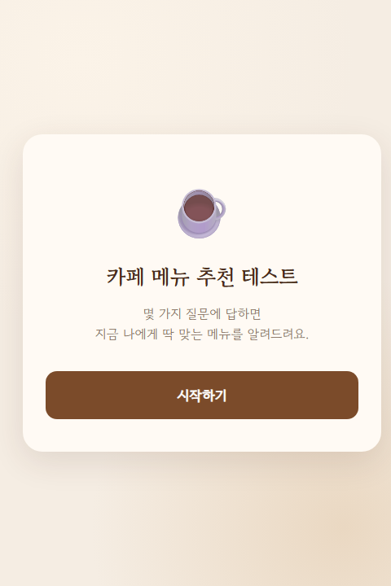
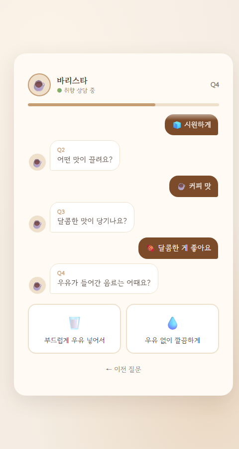
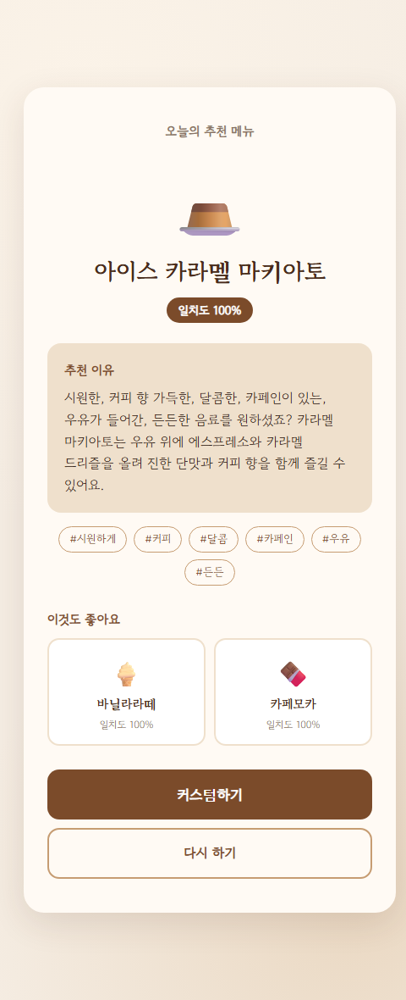
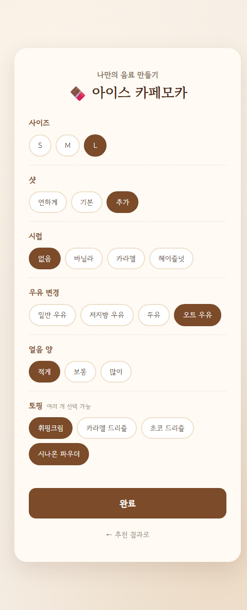
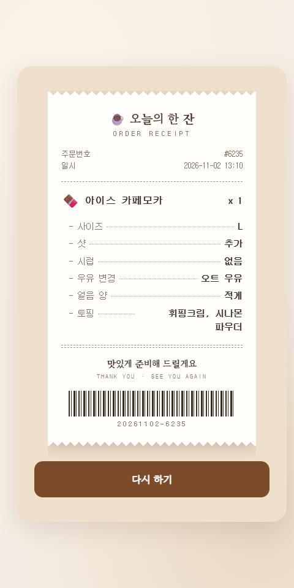

# ☕ 카페 메뉴 추천 테스트

> 질문 몇 개에 답하면 지금 나에게 딱 맞는 카페 메뉴를 추천해주는 웹 앱

- 과목: 인공지능 프로그래밍 — 본인이 만들고 싶은 앱을 바이브 코딩으로 만들어 보기
- 제작 도구: Claude Code (VS Code 확장)
- 기술: HTML, CSS, JavaScript (설치 없이 브라우저에서 바로 실행)

---

## 1. 제작한 것 소개

### 만든 이유
카페 아르바이트를 하면서 "뭐가 맛있어요?", "안 단 거 있어요?" 같은 질문을 자주 받았습니다.
메뉴가 많을수록 손님은 고르기 어렵고, 직원은 같은 설명을 반복하게 됩니다.
그래서 손님이 간단한 질문에 답하기만 하면 취향에 맞는 메뉴를 바로 알려주는 앱을 만들었습니다.

### 주요 기능
- **바리스타와 대화하며 답하기**: 바리스타가 말풍선으로 질문하고, 내 답은 말풍선으로 쌓임
- **선택에 따라 바뀌는 질문**: 온도 / 맛 계열 / 단맛 / 카페인 / 우유 / 든든함 중, 앞선 답과 모순되는 선택지는 숨기고 답이 정해진 질문은 건너뜀 (질문 2~5개)
- **메뉴 추천 + 추천 이유**: 메뉴 15개 중 답과 가장 잘 맞는 메뉴를 일치도(%)와 함께 추천하고, 이유와 태그로 설명
- **이것도 좋아요**: 2·3등 메뉴를 작은 카드로 함께 보여줌
- **커스텀하기**: 사이즈·샷·시럽·우유 변경·얼음 양·토핑 중 메뉴 종류에 맞는 옵션만 골라 나만의 음료 만들기
- **영수증 주문서**: 고른 옵션을 영수증 모양으로 정리해 직원에게 보여줄 수 있음
- **이전 질문 / 다시 하기**: 잘못 고른 답은 바로 고치고, 언제든 처음부터 다시 시작

### 스크린샷

| 시작 화면 | 질문 화면 (바리스타 대화) | 결과 화면 |
|:---:|:---:|:---:|
|  |  |  |

| 커스텀하기 | 영수증 주문서 |
|:---:|:---:|
|  |  |

### 실행 방법
`index.html` 파일을 브라우저로 열면 바로 실행됩니다.

---

## 2. PRD와 Todo 리스트 (최초 계획)

> ⚠️ 이 섹션은 **개발 시작 전에 작성한 최초 계획**입니다. 수정하지 않고 그대로 두고, 바뀐 내용은 3번 섹션에 기록합니다.

### PRD

**문제 정의**
- 손님은 메뉴가 많아 무엇을 고를지 어렵다
- 직원은 같은 메뉴 설명을 반복한다

**대상 사용자**
- 카페 메뉴를 처음 보는 손님

**목표**
- 1분 안에 질문에 답하고 나에게 맞는 메뉴를 추천받는다

**핵심 기능**
1. 시작 화면
2. 질문 4개를 한 화면에 하나씩 보여주기 (온도 / 단맛 / 카페인 / 우유)
3. 답변 조합에 맞는 메뉴 1개 추천 + 추천 이유
4. 다시 하기 버튼

**범위 밖**
- 로그인, 주문·결제, AI API 연동

**성공 기준**
- 모든 답변 조합에서 추천 결과가 나온다 (빈 결과 없음)
- 추천 메뉴가 답변 조건과 맞는다

### Todo 리스트 v1
- [ ] 메뉴 데이터 15개 작성
- [ ] 시작 화면
- [ ] 질문 화면 (4문항)
- [ ] 추천 로직
- [ ] 결과 화면 (메뉴 + 추천 이유)
- [ ] 다시 하기
- [ ] 모든 답변 조합 테스트

---

## 3. Todo 리스트 변경 내역

> 처음 계획(v1)과 비교해서 무엇이, 왜 바뀌었는지 기록합니다.

### 변경 요약

| 구분 | 항목 | 처음 계획 | 변경 후 | 이유 |
|---|---|---|---|---|
| 추가 | 이전 질문 버튼 | 없음 | 질문 화면에 "← 이전 질문" 버튼 | 잘못 누른 답을 처음부터 다시 하지 않고 바로 고칠 수 있게 하려고 |
| 추가 | 질문 진행 바 | 없음 | 질문 화면 위에 진행 바와 "1 / 4" 표시 | 질문이 몇 개 남았는지 보여줘서 1분 안에 끝난다는 걸 알 수 있게 하려고 |
| 추가 | 결과 태그 | 없음 | 결과 화면에 답변 태그(#따뜻하게, #달콤 등) 표시 | 추천 메뉴가 내 답과 맞는지 한눈에 확인할 수 있게 하려고 (성공 기준 2번) |
| 수정 | 추천 로직 | 답변 조합에 맞는 메뉴 1개 추천 | 조건이 많이 맞을수록 점수가 높고, 최고 점수 메뉴가 여러 개면 무작위로 1개 추천 | 딱 맞는 메뉴가 없어도 가장 가까운 메뉴가 나와 빈 결과를 막고, 다시 하면 다른 메뉴도 볼 수 있게 하려고 |
| 추가 | 일치도 표시 | 없음 | 1등 메뉴에 "일치도 OO%" 표시 (질문 4개 중 맞는 개수 × 25%) | 추천 메뉴가 내 답과 얼마나 맞는지 숫자로 보여줘서 추천을 더 믿을 수 있게 하려고 |
| 추가 | 이것도 좋아요 | 없음 | 결과 화면 아래에 2·3등 메뉴를 작은 카드로 표시 | 취향이 비슷한 다른 메뉴도 알려줘서 새로운 메뉴를 시도해 보게 하려고 |
| 테스트 후 변화 | 정확히 맞는 메뉴가 없을 때 | 답변 조합에 맞는 메뉴 1개 추천 | 일치도가 가장 높은 메뉴를 1등으로 추천 | 정확히 맞는 메뉴가 없어도 빈 결과 없이 가장 가까운 메뉴가 나오게 하려고 (성공 기준 1번) |
| 추가 | 커스텀하기 | 없음 | 결과 화면의 [커스텀하기] 버튼 → 사이즈·샷·시럽·우유 변경·얼음 양·토핑 선택 화면 (메뉴 종류에 맞는 옵션만 표시) | 추천 메뉴를 내 취향에 맞게 한 번 더 조절할 수 있게 하려고 |
| 추가 | 주문서 카드 | 없음 | [완료]를 누르면 고른 옵션을 정리한 주문서 카드 표시, "다시 하기"로 처음으로 | 정리된 주문서를 직원에게 보여주면 바로 주문할 수 있게 하려고 |
| 수정 | 질문 개수 | 질문 4개 (온도 / 단맛 / 카페인 / 우유) | 질문 6개 (온도 / 맛 계열 / 단맛 / 카페인 / 우유 / 든든함) | 4문항으로는 1등 메뉴가 여러 개라 무작위로 골랐는데, 맛 계열·든든함을 물어 취향에 더 맞는 메뉴를 고르려고 |
| 수정 | 주문서 디자인 | 주문서 카드 (점선 테두리 카드) | 영수증 디자인 (지그재그 절취선, 주문번호·일시, 점선 옵션 줄, 바코드, 출력 효과) | 실제 카페 영수증처럼 보여 진짜 주문한 것 같은 재미를 주고, 항목과 값이 줄로 정리돼 직원에게 보여줄 때 한눈에 읽히게 하려고 |
| 수정 | 질문 화면 디자인 | 질문을 한 화면에 하나씩 보여주기 (질문 + 세로 선택지 버튼) | 바리스타 대화형: 바리스타가 말풍선으로 한 질문씩 묻고, 고른 답이 내 말풍선으로 쌓임 | 실제 카페에서 바리스타에게 추천받는 것처럼 직원과 대화하는 느낌을 주려고 |
| 수정 | 질문 흐름 | 질문 4개를 정해진 순서로 모두 묻기 | 앞선 답에 맞춰 나올 수 없는 선택지는 숨기고, 답이 이미 정해진 질문은 건너뜀 (질문 2~5개) | "우유 없이" + "든든하게"처럼 맞는 메뉴가 없는 모순된 답을 고를 수 있어서, 선택에 따라 다른 질문이 나오게 하려고 |

### 상세 기록
<!-- todo-log 스킬로 변경이 생길 때마다 추가 -->

#### 2026-11-02
- **무엇이 바뀌었나**
  - 질문 화면에 "← 이전 질문" 버튼 추가
  - 질문 화면에 진행 바와 "1 / 4" 표시 추가
  - 결과 화면에 답변 태그(#따뜻하게, #달콤 등) 추가
  - 추천 로직을 점수 방식으로 변경: 온도·단맛·카페인·우유 조건이 맞을 때마다 1점씩 주고, 최고 점수 메뉴 중 하나를 무작위로 추천
- **왜 바뀌었나**
  - 이전 질문 버튼: 잘못 누른 답을 처음부터 다시 하지 않고 바로 고칠 수 있게 하려고
  - 진행 바: 질문이 몇 개 남았는지 보여줘서 1분 안에 끝난다는 걸 알 수 있게 하려고
  - 결과 태그: 추천 메뉴가 내 답과 맞는지 한눈에 확인할 수 있게 하려고 (성공 기준 2번)
  - 추천 로직: 빈 결과를 막고, 다시 하면 다른 메뉴도 볼 수 있게 하려고
- **관련 커밋**: `e83fb56` feat: 카페 메뉴 추천 테스트 기본 기능 구현

#### 2026-11-02 (결과 화면 개선)
- **무엇이 바뀌었나**
  - 모든 메뉴의 일치도(%)를 계산해 높은 순으로 정렬하고, 1등 메뉴에 "일치도 OO%" 표시
  - 결과 화면에 "이것도 좋아요" 섹션을 추가해 2·3등 메뉴를 작은 카드(이모지, 이름, 일치도)로 표시
  - 정확히 맞는 메뉴가 없어도 일치도가 가장 높은 메뉴가 1등으로 나오게 함 (메뉴 하나를 빼고 테스트해서 75% 메뉴가 추천되는 것을 확인)
- **왜 바뀌었나**
  - 일치도 표시: 추천 메뉴가 내 답과 얼마나 맞는지 숫자로 보여줘서 추천을 더 믿을 수 있게 하려고
  - 이것도 좋아요: 취향이 비슷한 다른 메뉴도 알려줘서 새로운 메뉴를 시도해 보게 하려고
  - 정확히 맞는 메뉴가 없을 때: 빈 결과 없이 가장 가까운 메뉴가 나오게 하려고 (성공 기준 1번)
- **관련 커밋**: `23efb06` feat: 결과 화면 수정, 일치도 계산

#### 2026-11-02 (커스텀하기)
- **무엇이 바뀌었나**
  - 결과 화면에 [커스텀하기] 버튼 추가 → 옵션 선택 화면으로 이동
  - 옵션 6종: 사이즈(S/M/L), 샷(연하게/기본/추가), 시럽, 우유 변경, 얼음 양, 토핑(여러 개 선택 가능)
  - 메뉴마다 종류(커피·콜드브루·논커피 라떼·차·에이드)를 정하고, 종류에 맞는 옵션만 보이게 함
    - 샷은 에스프레소 커피만, 우유 변경은 우유가 들어간 메뉴만, 얼음 양은 아이스 음료만
    - 차·에이드는 샷·시럽·우유 옵션 없음, 토핑도 메뉴 종류에 맞는 것만 표시
  - [완료]를 누르면 고른 옵션을 정리한 주문서 카드를 보여주고, "다시 하기"로 처음 화면으로 돌아감
  - 실제 주문·결제는 하지 않음 (PRD 범위 밖 유지)
- **왜 바뀌었나**
  - 커스텀하기: 추천 메뉴를 내 취향에 맞게 한 번 더 조절할 수 있게 하려고
  - 주문서 카드: 정리된 주문서를 직원에게 보여주면 바로 주문할 수 있게 하려고
- **관련 커밋**: `40f0300` feat: 커스텀하기와 주문서 화면 추가, 글씨체 변경

#### 2026-11-02 (질문 6개로 확장)
- **무엇이 바뀌었나**
  - 질문 2개 추가: "어떤 맛이 끌려요?"(커피 맛 / 상큼한 과일 맛 / 고소하고 부드러운 맛 / 은은한 차 맛), "지금 배고픈 정도는 어때요?"(가볍게 / 든든하게)
  - 메뉴 15개에 맛 계열(flavors, 여러 개 가능)과 든든함(heavy) 정보 추가
  - 일치도를 6문항 기준으로 계산 (문항당 약 17%), 추천 이유와 결과 태그에도 맛 계열·든든함 반영
  - 시작 화면 안내 문구를 "질문 6개"로 변경
  - 128가지 답변 조합을 모두 테스트: 빈 결과 없음, 1등 일치도는 최소 67%, 메뉴 15개 모두 1등으로 나올 수 있음
- **왜 바뀌었나**
  - 4문항으로는 1등 메뉴가 여러 개라 무작위로 골랐는데, 맛 계열·든든함을 물어 취향에 더 맞는 메뉴를 고르려고
- **관련 커밋**: `a201d1f` feat: 질문 6개로 확장 (맛 계열, 든든함 추가)

#### 2026-11-02 (주문서 영수증 디자인)
- **무엇이 바뀌었나**
  - 주문서 카드를 영수증 모양으로 변경: 위아래 지그재그 절취선, 그림자, 주문서 화면에서는 바깥 카드를 진한 크림색으로 바꿔 종이가 또렷하게 보이게 함
  - 영수증 구성: 가게 이름("☕ 오늘의 한 잔"), 주문번호(무작위 4자리)·일시, 메뉴 이름 x 1, "- 사이즈 ······ L"처럼 점선으로 잇는 옵션 줄, 인사말, 장식용 바코드와 코드
  - 영수증 글꼴을 고정폭 글꼴(나눔고딕코딩)로 변경
  - 주문서가 열릴 때 영수증이 위에서부터 출력되듯 내려오는 효과 추가
  - 주문번호·바코드는 분위기용이며 실제 주문과는 무관 (PRD 범위 밖 유지)
- **왜 바뀌었나**
  - 실제 카페 영수증처럼 보여 진짜 주문한 것 같은 재미를 주려고
  - 항목과 값이 줄로 정리돼 직원에게 보여줄 때 한눈에 읽히게 하려고
- **관련 커밋**: `522300b` feat: 주문서를 영수증 디자인으로 변경

#### 2026-11-02 (질문 화면 바리스타 대화형)
- **무엇이 바뀌었나**
  - 질문 화면을 채팅 형태로 변경: 바리스타(☕)가 인사 후 말풍선으로 질문하고, 내가 고른 답은 오른쪽 갈색 말풍선으로 쌓임
  - 질문마다 "Q1"처럼 번호 표시, 바리스타가 "입력 중(…)" 표시 후 질문을 보냄
  - 선택지는 대화창 아래 답장 카드로 표시 (2지선다는 좌우 2칸, 4지선다는 2×2)
  - 위쪽 헤더에 바리스타 이름·"취향 상담 중"·진행 상황(Q3 / 6)과 얇은 진행 바 표시
  - 마지막 답을 보내면 바리스타가 "딱 맞는 한 잔 고르는 중이에요…"라고 한 뒤 결과 화면으로 넘어감
  - "← 이전 질문"은 그대로 유지 (대화가 한 단계 전으로 돌아감)
  - 질문은 여전히 한 번에 하나씩 나옴 (PRD 핵심 기능 2번 유지)
- **왜 바뀌었나**
  - 실제 카페에서 바리스타에게 추천받는 것처럼 직원과 대화하는 느낌을 주려고
- **관련 커밋**: `290286d` feat: 질문 화면을 바리스타 대화형으로 변경

#### 2026-11-02 (선택에 따라 바뀌는 질문 흐름)
- **무엇이 바뀌었나**
  - 답할 때마다 지금까지의 답에 모두 맞는 메뉴만 남기고, 다음 질문을 그 메뉴에 맞춰 조절
    - 남은 메뉴로 나올 수 없는 선택지는 숨김 (예: "우유 없이"를 고르면 든든함 질문에서 "든든하게"가 사라짐)
    - 선택지가 하나만 남는 질문은 묻지 않고 답을 자동으로 정함 (예: "고소하고 부드러운 맛"을 고르면 우유 질문을 건너뜀)
  - 질문 수가 경로에 따라 2~5개로 달라짐 → 진행 표시를 "Q3 / 6"에서 "Q3"으로, 시작 화면 문구를 "몇 가지 질문에 답하면"으로 변경
  - "← 이전 질문"을 누르면 바로 전에 물어본 질문으로 돌아가고, 그 뒤의 답(자동으로 정해진 답 포함)은 지움
  - 일치도 계산은 질문 데이터를 기준으로 하도록 정리
  - 테스트: 가능한 29개 경로를 모두 확인해 1등이 항상 일치도 100%이고, 메뉴 15개 모두 100%로 추천될 수 있음을 확인. 브라우저에서 질문 건너뛰기와 이전 질문 동작 확인
  - 기존에 메뉴가 없던 답 조합 4가지: 과일 맛 + 달지 않게, 고소한 맛 + 우유 없이, 달지 않게 + 든든하게, 우유 없이 + 든든하게
- **왜 바뀌었나**
  - "우유 없이" + "든든하게"처럼 맞는 메뉴가 없는 모순된 답을 고를 수 있어서, 선택에 따라 다른 질문이 나오게 하려고
- **관련 커밋**: `4bc08ae` feat: 선택에 따라 바뀌는 질문 흐름

### 최종 Todo 리스트

**처음 계획(v1) 항목**
- [x] 메뉴 데이터 15개 작성 → 맛 계열·든든함·메뉴 종류 정보 추가
- [x] 시작 화면
- [x] 질문 화면 → 질문 4개에서 6개로 확장, 바리스타 대화형 디자인, 선택에 따라 바뀌는 질문 흐름(2~5개)
- [x] 추천 로직 → 일치도(%) 점수 방식
- [x] 결과 화면 (메뉴 + 추천 이유)
- [x] 다시 하기
- [x] 모든 답변 조합 테스트 → 가능한 29개 경로 모두 1등 일치도 100%, 빈 결과 없음

**개발하면서 추가한 항목**
- [x] 이전 질문 버튼
- [x] 질문 진행 표시
- [x] 결과 태그
- [x] 일치도 표시
- [x] 이것도 좋아요 (2·3등 메뉴)
- [x] 커스텀하기 (메뉴 종류에 맞는 옵션만 표시)
- [x] 주문서 → 영수증 디자인

---

## 4. 스킬

### todo-log (직접 제작)

**SKILL.md**
```markdown
---
name: todo-log
description: 기능을 수정·추가·삭제했거나 테스트 후 계획이 바뀌었을 때, README.md의 "3. Todo 리스트 변경 내역" 섹션에 처음 계획(v1)과 비교한 변경 사항을 기록한다.
---

# Todo 변경 기록 스킬

## 언제 쓰나
- 기능을 수정했을 때
- 테스트 후 무언가 바뀌었을 때
- Todo 항목을 빼거나 새로 넣었을 때

## 규칙
1. README.md의 "2. PRD와 Todo 리스트 (최초 계획)" 섹션은 절대 수정하지 않는다.
2. "3. Todo 리스트 변경 내역"의 **변경 요약 표**에 한 줄을 추가한다.
   - 구분: 수정 / 추가 / 삭제 / 테스트 후 변화 중 하나
   - 항목, 처음 계획, 변경 후, 이유를 채운다
   - 처음 계획에 없던 항목이면 "처음 계획" 칸에 "없음"이라고 쓴다
3. **상세 기록**에 오늘 날짜(YYYY-MM-DD) 제목으로 아래 형식을 추가한다.
   - 무엇이 바뀌었나
   - 왜 바뀌었나
   - 관련 커밋 (커밋했다면 커밋 메시지)
4. 이유는 사용자에게 확인한다. 추측해서 쓰지 않는다.
5. 기록 후 무엇을 추가했는지 사용자에게 짧게 보여준다.
```

**만든 이유**
- 이번 과제는 처음 계획과 바뀐 점을 반드시 기록해야 하는데, 개발하면서 매번 직접 정리하면 빠뜨리기 쉽다
- 그래서 기능을 수정하거나 테스트 후 바뀐 점이 생길 때마다, Claude Code가 정해진 형식으로 README에 기록하도록 스킬로 만들었다

**작업에서 어떻게 쓰였나**
- 기능을 추가하거나 바꿀 때마다 todo-log 스킬로 3번 섹션에 기록했다 (상세 기록 7건, 변경 요약 표 13줄)
  - 이전 질문 버튼·진행 바·결과 태그 추가, 추천 로직을 점수 방식으로 수정
  - 일치도 표시·이것도 좋아요 추가, 정확히 맞는 메뉴가 없을 때도 결과가 나오도록 변경
  - 커스텀하기·주문서 추가, 질문 4개 → 6개 확장
  - 주문서 영수증 디자인, 질문 화면 바리스타 대화형으로 변경
  - "우유 없이 + 든든하게"처럼 모순된 답을 고를 수 있다는 걸 발견해, 선택에 따라 바뀌는 질문 흐름으로 수정
- 스킬 규칙 4번("이유는 사용자에게 확인한다")대로, Claude Code가 기록 전에 변경 이유를 선택지로 물어보고 내가 고른 이유만 기록했다
- 커밋한 뒤에는 상세 기록의 "관련 커밋"에 커밋 번호와 메시지를 채워 넣어, 어떤 변경이 어느 커밋인지 바로 찾을 수 있게 했다
- 2번 섹션(최초 계획)은 규칙 1번대로 한 번도 수정하지 않았다

---

## 5. 느낀점, 결론

### 바이브 코딩을 해보며 느낀 점
- **기획이 계속 바뀌었다**: 처음에는 질문 4개짜리 간단한 앱이었는데, 만들어 보면서 일치도, 커스텀하기, 영수증, 바리스타 대화형까지 아이디어가 계속 늘어났다. 바뀐 점을 todo-log로 기록해 두니 처음 계획과 비교해 무엇이 왜 바뀌었는지 한눈에 보였다.
- **설명을 잘해야 원하는 결과가 나온다**: "결과 화면 개선해줘"보다 "1. 일치도 표시 2. 2·3등 카드 3. 맞는 메뉴가 없어도 결과 표시"처럼 번호를 붙여 구체적으로 말했을 때 한 번에 원하는 대로 만들어졌다.
- **직접 써 보고 확인하는 게 중요하다**: AI가 만든 결과를 그대로 믿지 않고 직접 눌러 보다가 "우유 없이 + 든든하게"처럼 맞는 메뉴가 없는 답을 고를 수 있다는 문제를 찾았고, 선택에 따라 바뀌는 질문 흐름으로 고칠 수 있었다.

### 잘 된 점 / 아쉬운 점
- **잘 된 점**
  - 영수증 주문서: 실제 카페 영수증처럼 보여서 직원에게 보여주기 좋고, 진짜 주문한 것 같은 재미가 있다.
  - 모순 없는 질문 흐름: 앞선 답에 맞춰 질문과 선택지가 바뀌어서, 어떤 길로 답해도 항상 딱 맞는 메뉴가 나온다.
- **아쉬운 점**
  - 메뉴가 15개뿐이라 "상큼한 과일 맛 + 달지 않게"처럼 고를 수 없는 조합이 있다.
  - 내가 일하는 카페의 실제 메뉴와 가격이 아니라 예시 데이터로 만들었다.
  - 처음부터 더 자세히 기획했다면 질문 개수나 화면 구성을 여러 번 고치지 않아도 됐을 것 같다.

### 결론
- 카페 아르바이트를 하며 느낀 "메뉴 고르기 어려움"을 바이브 코딩으로 직접 해결해 볼 수 있었다. 코드를 직접 짜지 않아도 원하는 것을 구체적으로 설명하고, 결과를 직접 확인하며 고쳐 나가면 생각보다 완성도 높은 앱을 만들 수 있다는 걸 알게 됐다.

### 향후 계획
- [ ] AI API를 연결해서 자유롭게 대화로 추천받기
- [ ] 실제 카페 메뉴 데이터 적용
- [ ] 메뉴를 늘려서 고를 수 없는 조합 줄이기
